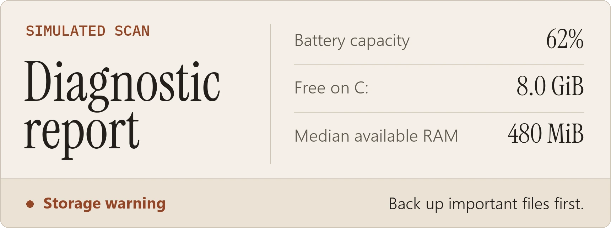

# Fahmi Aufa

Informatics student at Telkom University. I build web projects and explore how typography, motion, and interaction shape an interface.

## CheckMyLaptop

Windows laptop diagnostics for battery, storage, drivers, and performance. Scans run locally and explain what to check first. Built with Python and Go.

**[View repository](https://github.com/raiju365/CheckMyLaptop)** · [Panduan Bahasa Indonesia](https://github.com/raiju365/CheckMyLaptop/blob/main/docs/panduan-id.md)

<picture>
  <source media="(max-width: 600px) and (prefers-color-scheme: dark)" srcset="./checkmylaptop-report-compact-dark.webp">
  <source media="(max-width: 600px) and (prefers-color-scheme: light)" srcset="./checkmylaptop-report-compact-light.webp">
  <source media="(prefers-color-scheme: dark)" srcset="./checkmylaptop-report-dark.webp">
  
</picture>

## Other work

- **[Otherflavos](https://otherflavos.vercel.app/)** · [Source](https://github.com/raiju365/otherflavos) An interactive portfolio with a project gallery, switchable themes, and three browser puzzles.
- **[FLAVOS](https://flavos-dusky.vercel.app/)** · [Source](https://github.com/raiju365/flavos) An editorial portfolio that pairs classical artwork with an orbital project gallery.
- **[Class Leader Voting DApp](https://github.com/raiju365/class-leader-voting-dapp)** A Rust smart contract on Stellar that registers candidates, records votes, and returns vote totals using Soroban.

[All repositories](https://github.com/raiju365?tab=repositories)
