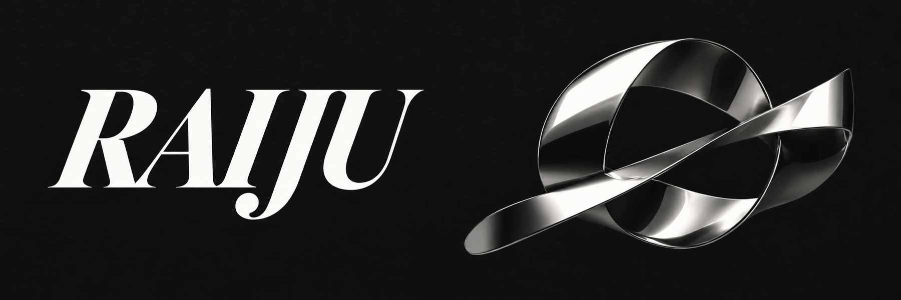
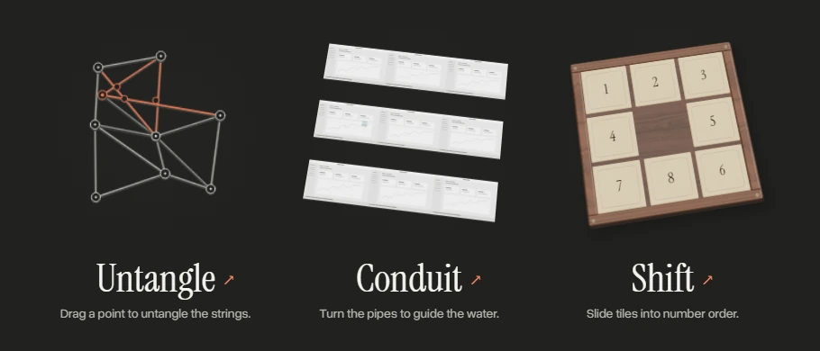

# Fahmi Aufa

Informatics student at Telkom University. I build web projects and explore how typography, motion, and interaction shape an interface.

## Selected work

### Otherflavos

An interactive portfolio with a project gallery, switchable themes, and three browser puzzles. Built with JavaScript and Vite.

[Open site ↗](https://otherflavos.vercel.app/) · [Source code](https://github.com/raiju365/otherflavos)

### FLAVOS

An editorial portfolio that pairs classical artwork with an orbital project gallery.

[Open site ↗](https://flavos-dusky.vercel.app/) · [Source code](https://github.com/raiju365/flavos)

### Class Leader Voting DApp

A Rust smart contract on Stellar that registers candidates, records votes, and returns vote totals using Soroban.

[Source code](https://github.com/raiju365/class-leader-voting-dapp)

---

[All repositories ↗](https://github.com/raiju365?tab=repositories)
